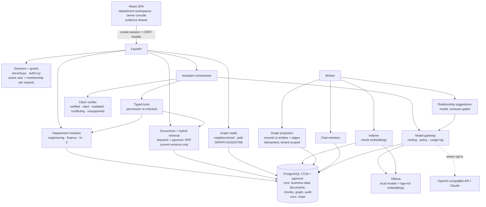
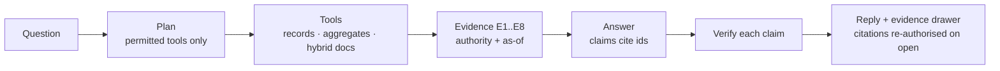

# Architecture

Abteilo is a modular monolith:
- one FastAPI application;
- one PostgreSQL database with pgvector;
- one background worker;
- a React single-page app served by the API.

**Status:** developer-tested against real PostgreSQL; not production-hardened.

**Evidence flow of an answer (today):**

Combined answers add:
- graph evidence with live-record re-reads (`graph.related`);
- information needs and a sufficiency gate before the answer;
- verified relationship and causal rules;
- outcomes (`answered`, `partial`, `insufficient`, `conflicting`) with the missing facts;
- a streaming endpoint that sends each claim only after verification.

## Data planes

| Schema | Contents | Who can delete |
|---|---|---|
| `core` | Company, departments, roles, projects, tasks, budgets, requests, documents with versions, chunks and embeddings, knowledge graph (entities, relationships, evidence, candidates), model registry, usage metadata, audit | Nobody through the application (no `DELETE` grant). Archive, deactivate or end instead. |
| `conv` | Conversations and messages; generated reports (`conv.reports`, typed JSON, immutable, expiring) | The owning user (deleting a chat deletes its reports); the retention job for expired rows |

Both schemas use Row-Level Security keyed on `app.company_id`, set per
transaction by trusted code. `conv` adds `app.user_id`, so chats are visible
only to their owner. The application connects as a role that owns nothing and
has no `BYPASSRLS`; migrations run as the schema owner.

## Request flow of an assistant question

This is the combined-answer flow (`ai/orchestrator.py`), the same for `POST /api/assistant/messages` and `/stream`.

1. **Principal.** Session cookie → principal; grants and membership status are loaded fresh on every request.
2. **Workspace check.** The user must belong to the department, or hold the owner report permission for the owner workspace.
3. **Plan.** The routed model (`qwen2.5:7b` by default) sees only the tools this user may use here. It returns:
   - up to 4 information needs, each typed `current_state`, `quantity`, `relationship`, `causal`, `policy` or `open`;
   - up to 4 tool calls. The schema constrains each call's arguments to that tool's own argument model, and invalid or disallowed calls are dropped.
4. **Retrieve.** Every call is re-checked and runs in the user's tenant context. Sources:
   - typed record tools;
   - hybrid document search, current versions only;
   - `graph.related`: the visible neighbourhood of one named record, with every status re-read live, logged in the graph-read log.

   Inactive members are never named in evidence; the modules return a typed `*_active` field. Evidence is bounded at 12 items and 12 000 characters. A graph timeout degrades the answer, it never fails it.
5. **Sufficiency gate.** If no need can be covered by the kind of source found, the model is not asked to answer: the outcome is `insufficient`, with the missing facts.
6. **Answer.** The model writes a summary and claims from the evidence only. The generation schema requires at least one evidence id per claim. Evidence is passed as data, never as instructions.
7. **Verify** (`ai/evidence.py`). Numbers, codes, names and statuses are checked on the line of the subject the claim names.
   - **Live records win over documents** (`outdated`, `conflicting`).
   - **Relationship claims** need a current edge between the two named records.
   - **Causal claims** are `verified` only through a reviewed or record `blocked_by` / `delays` edge. A `depends_on` / `affects` edge, or a source sentence, makes them at most `cited`.
8. **Outcome.** `answered`, `partial`, `insufficient` or `conflicting`, from the verified statements and need coverage. Retrieval scores never contribute.
9. **Stream** (`/stream`). Server-Sent Events: stage → evidence → summary → each claim as soon as it is verified → final. A disconnect stops generation; only a completed reply is stored.
10. **Persist.** The chat goes in `conv` with evidence references only (no source content). Usage metadata goes in `core.ai_runs`.

## Generated reports and answer exports

Details and rules: [REPORTS.md](REPORTS.md). Code: `abteilo/reports.py` (service, rendering, download routes),
`abteilo/report_data.py` (collectors).

A chat message that asks for a document (deterministic detection: "PDF", "Word", "make a report", German
equivalents) does **not** go through the question flow above. Instead:

1. **Kind and permission.** The workspace decides the report kind (Engineering progress, Finance status, leave
   requests, access requests, company status). The requester needs the permission that area's screens need.
2. **Collect** (no model). Every record in scope is enumerated with the module functions the business screens
   use; tables are built directly from the rows. Bounds: 20 sections, 40 rows per table; anything beyond makes
   the report **partial** and names what is missing. Evidence for the narrative comes from the same typed tools
   as chat answers (record tools, reviewed relationships, the most relevant current document), bounded like a
   chat answer; inactive members are never named.
3. **Narrative.** One model call (stage `report`, streamed, cancellable) writes a summary, up to 12 observations
   and up to 4 next steps, each citing evidence ids.
4. **Verify.** Observations go through the same verifier as answers; only `verified`, `cited` or `conflicting`
   statements enter the document. An unsupported summary is replaced by a summary computed from the records.
   Next steps are labelled suggestions and dropped if they mention anything absent from the evidence,
   contradict a status or state any cause.
5. **Store.** The typed `Report` is stored with the chat reply in `conv.reports` (owner-private RLS, no UPDATE
   grant, expires after at most 30 days or the chat retention, deleted with its chat).
6. **Download** (`GET /api/reports/{id}?format=pdf|docx`). Permissions are re-checked at every download: the
   report's area permission, the department and module, and every document source. The file is rendered in
   memory (ReportLab, python-docx), never written to disk. Creation and each download are audited (metadata only).

**Answer export** (`GET /api/conversations/{c}/messages/{m}/export`) turns an existing answer into PDF or Word,
labelled as an export of a past answer that was not re-checked. It re-checks the workspace, every tool the
answer used and every document source.

## Knowledge graph

- **Projection.** The worker rebuilds each company's graph from its business records in one transaction per company. The run is idempotent, so a repeat with no changes changes nothing, and a failure rolls back as a whole. Person entities are scoped to the company's memberships. The database refuses a person without a membership in the same company (GRAPH-11, migration `0006`).
- **Relationships.**
  - `record`: from a foreign key;
  - `document_mention`: a project code in the current document version;
  - `reviewed`: a model suggestion that a department editor accepted.

  Every edge has evidence and is ended, never deleted.
- **Reads.** Every entity and edge is filtered by the reader's live grants. Hidden entities cut paths and are never named. Departments and people are hubs, not stepping stones. Depth, size and time are bounded.

## Extending

| Change | Where | Code change? |
|---|---|---|
| New department | Owner console → Departments (custom template) | No |
| New dedicated model | Owner console → AI models → add profile, then route | No |
| New provider type | `abteilo/ai/providers.py`: implement `complete_json`, register in `PROVIDERS` | Small |
| New assistant tool | `abteilo/ai/tools.py` + template allowlist in `abteilo/templates.py` | Small |
| New department module | New router in `abteilo/modules/`, migration for its tables, template entry | Yes |

## Production checklist

- HTTPS in front of the API (reverse proxy or platform load balancer); keep
  `ABTEILO_COOKIE_SECURE=true`.
- Managed PostgreSQL preferred; run `alembic upgrade head` as the owner role on
  deploy, the app as the runtime role.
- `/healthz` (liveness) and `/readyz` (database reachable) for orchestration.
- Secrets from the platform's secret manager, never from files in the image.
- Structured JSON access logs (no bodies, no query strings) to your log
  pipeline; alert on 5xx rate and model error rate.
- Automated encrypted backups with tested restores.
- Run one or more `worker` processes for chat retention and report expiry.
