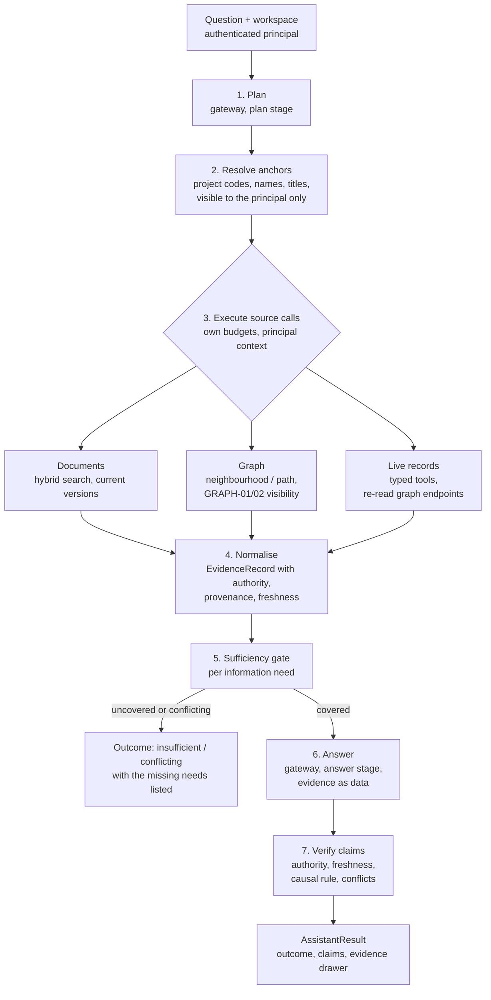

# Block D — Unified Enterprise Intelligence: Design

**Status:** the design was approved, and D1-D9 are implemented on the development machine (2026-10-20). Measured results are in `ACCEPTANCE.md` (Block D) and `EVALUATION.md`. Section 10 lists where the build differs from this design. The sealed evaluation split is not yet run: it is to be written independently.

**Sources of truth this design builds on:**
- `ENGINEERING_CONTRACT.md`: invariants AUTH, AI, RAG, GRAPH-01..11, DATA.
- `ACCEPTANCE.md`: Blocks A-C, Docker verification, open P1 items.
- `EVALUATION.md`: Block B measurements and the 2026-10-20 answerability follow-up.
- `PRIVACY_AND_GDPR.md`: minimisation, purpose limitation, no per-person monitoring.
- The code as of 2026-10-20: `ai/orchestrator.py`, `ai/tools.py`, `ai/evidence.py`, `graph.py`, `modules/*`.

**Constraints:**
- Keep the four departments, the owner console and the UI design system.
- Reuse FastAPI, PostgreSQL, pgvector, the graph and the model gateway.
- No new services, no fine-tuning, no new model.

---

## 1. Problem statement

Today the assistant plans up to three typed tool calls, gathers evidence (documents and live records), lets the model draft claims and verifies each claim deterministically. Three gaps remain:

1. **The graph is not used.** Questions that span records ("why is A17 blocked, and what is waiting in Finance for it?") need several lookups that no single tool performs.
2. **Relevance is treated as answerability.** Retrieval returns whatever passes the similarity threshold, and the measured trade-off has no good setting (`EVALUATION.md`, follow-up):

   | bge-m3 hybrid threshold | Recall@5 | Unanswerable questions abstained |
   |---|---|---|
   | 0.45 | 0.92 | 10/10 |
   | 0.55 | 1.00 | 5/10 |
   | 0.65 | 1.00 | 2/10 |

   A threshold cannot decide whether a question can be answered.
3. **Freshness and causality are implicit.**
   - The verifier already prefers live records and refuses word-matched causes.
   - There is no notion of "this question needs a current-state fact", "this needs a cause" or "this relationship came from a projection that may lag".

## 2. Architecture

### 2.1 Placement

The Enterprise Intelligence Service (EIS) is an in-process package, `abteilo/intelligence/`. It replaces the retrieval half of `ai/orchestrator.run`:

- **What stays the same:** the planner and answer stages keep using `ai/gateway.py` (routing, policy, usage log); `ai/evidence.py` stays the verifier and is extended.
- **What does not change:** the HTTP endpoint (`POST /api/assistant/messages`) keeps its request body. Its response gains fields without removing any (§4.4).



### 2.2 Steps

1. **Plan.** The routed model sees only the tools this principal may use in this workspace (unchanged rule). It returns:
   - up to 4 source calls;
   - up to 4 information needs (§3.1). A need is a typed statement of what the answer must establish, for example `{type: current_state, subject: "A17", attribute: "status"}`.

   Proposals that fail validation are dropped (unchanged). If the plan has no needs, one `open` need is derived from the question.
2. **Resolve anchors.** Entity mentions are turned into `EntityRef(kind, ref_id)` deterministically, never by the model:
   - project codes (`\b[A-Z]\d{2}\b`);
   - document titles;
   - people by display name, from the directory the principal can see.

   Resolution runs under the principal's RLS context and the same visibility predicates as the graph and modules. An unresolvable or hidden mention becomes an unresolved anchor. It is not an error, and the model is never told whether a hidden entity exists.
3. **Execute.** Each source call runs in its own short transaction (`transaction(company_id, user_id)`), with its own time budget (§5.5). Sources:

   | Source | Implementation | Returns |
   |---|---|---|
   | `documents.search` | Existing `hybrid_search` (RAG-01..05) | Passages from current versions |
   | `graph.neighbourhood(anchor, depth<=2)` and `graph.path(a, b, <=4)` | Existing `graph.neighbourhood` / `graph.path` (GRAPH-01/02/07/08) | Edges with authority and evidence |
   | `records.*` | Existing typed tools (`engineering.get_project`, `finance.purchase_requests`, ...), plus `records.lookup(EntityRef)` | The current row of any entity a graph call surfaced, re-read from its business table under module permissions |

   **Graph to live rule.** The graph is used to find what is related, never as the source of current state. Every entity a graph result returns, and that a need asks about, is re-read through `records.lookup` in the same request (§3.4).
4. **Normalise.** Every item becomes an `EvidenceRecord` (§4.2) with a request-local id (`E1`...).
5. **Sufficiency gate** (§3). This is a deterministic check of need coverage before any answer is drafted:
   - **All needs uncovered:** the outcome is `insufficient`, no answer call is made, and the reply lists what is missing in plain language.
   - **Only some needs covered:** the answer proceeds, and the outcome is at most `partial`.
6. **Answer.** Unchanged prompt discipline: evidence is passed as data, and every claim cites evidence ids. In addition, each claim states its type (`current_state`, `quantity`, `relationship`, `causal`, `policy`, `narrative`).
7. **Verify.** The `ai/evidence.py` rules are kept and extended (§3.3). The outcome is derived from the verified claims and need coverage, never from retrieval scores.

## 3. Evidence sufficiency and answerability

### 3.1 Information needs

| Need type | Example | Covered only by |
|---|---|---|
| `current_state` | "Is A17 blocked?" | A live `record` or `aggregate` about the subject entity, observed in this request |
| `quantity` | "How much budget is left?" | A `record` or `aggregate` carrying the field (amounts from structured fields, not text) |
| `relationship` | "Which purchase requests are for A17?" | A graph edge with authority `record` or `reviewed` between the anchors, re-confirmed by `records.lookup` of both endpoints |
| `causal` | "Why is A17 blocked?" | See §3.3 |
| `policy` | "How many leave days carry over?" | A current-version document passage that a verified or cited claim actually quotes |
| `open` | Anything else | At least one claim that passes verification |

**Relevance is not coverage.**
- A retrieved passage covers a need only if a claim citing it passes verification.
- Retrieval scores (distance, RRF rank) select candidates. They never contribute to the outcome.
- An unanswerable question that retrieves related text therefore still ends as `insufficient`: no claim survives verification.

### 3.2 Outcomes

| Outcome | Condition | UI |
|---|---|---|
| `answered` | Every need is covered and every claim is `verified` or `cited` | Normal reply |
| `partial` | At least one need is covered and at least one is not | Reply plus "Not determined from available evidence: ..." for each uncovered need |
| `insufficient` | No need is covered | "Cannot determine from available evidence", with what was looked for. No speculative text. |
| `conflicting` | Live records disagree with each other on a needed fact | Both values, both sources, no choice made by the model |

The existing `ReplyStatus` maps across directly: `verified` becomes `answered`, `partially_verified` becomes `partial`, `insufficient_evidence` becomes `insufficient`. The field is kept for compatibility.

### 3.3 Claim rules

The existing rules are unchanged:
- `verified` = a structured fact matched a live record or aggregate;
- `cited` = narrative wording found in the cited source;
- `outdated` = only an older document says it;
- `conflicting` = records disagree;
- `unsupported` = everything else.

Block D adds four rules.

- **Field-level verification.** Records and aggregates carry `fields` (status, amount, period, code, assignee). Status and quantity claims are checked against those fields, not against regex matches over text. Text matching remains only for documents.
- **Relationship claims.**
  - `verified` only if a current edge (`valid_to IS NULL`) with authority `record` or `reviewed` links the two cited entities, and both endpoints were re-read live in this request.
  - `document_mention` edges support only "document X mentions project Y".
  - Edges from a projection older than the freshness bound (§3.4) give `cited` with reason `relationship_projection_stale`.
- **Causal claims.** A claim with causal wording ("because", "due to", "caused by", "blocked by", "delays") is:
  - **`verified`** only if a causal edge kind (`blocked_by`, `depends_on`, `delays`, `affects`) with authority `record` or `reviewed` connects effect to cause, along a path of at most 2 such edges. Each endpoint must be re-read live.
  - **`cited`** with reason `causal_link_stated_in_source`, if a current document sentence states the cause (existing rule).
  - **`unsupported`** with reason `causal_link_not_in_evidence` otherwise. In particular, a path made of structural edges (`owns`, `has_task`, `requested_for`, `assigned_to`, `member_of`, `mentions`) never establishes a cause, however short it is. "The rig request is for A17" is a relationship, not a reason for the block.
- **Negative claims.** "No purchase is pending" needs an `aggregate` or list record that covers the whole scope asked about (for example the list tool returned complete, not truncated). Otherwise the claim is `unsupported` with reason `absence_not_established`.

### 3.4 Authority and freshness

**Authority order for current-state facts:** live `record` > `aggregate` > graph `relationship` (record-derived) > `reviewed` relationship > `document_mention` > `document`. Documents never verify current state. They remain available as historical context and are labelled with their version date.

**Freshness:**

| Source | `as_of` | Freshness rule |
|---|---|---|
| Live record or aggregate | Query time | Always `live` |
| Graph edge | `graph_projection_state.last_finished_at` | The edge is navigation only. Facts about its endpoints come from `records.lookup`. If the projection is older than 10 minutes (configurable) or its last run failed, relationship claims are at most `cited` (`relationship_projection_stale`), and the reply says so. |
| Document passage | Version `created_at` | Only current versions are retrievable (RAG-02). When a document disagrees with a live record, the record wins and the document claim is `outdated` (existing). |

### 3.5 Unavailable, stale or contradictory evidence

| Situation | Handling | Never |
|---|---|---|
| Embedding model down | Keyword-only documents (OPS-01), with `degradations: [documents.semantic_unavailable]` | Wider access |
| Graph timeout, failure or stale | Drop graph evidence; relationship and causal needs uncovered; `degradations: [graph.*]` | Falling back to unfiltered traversal |
| Record tool fails | That need is uncovered; the safe error code goes into `degradations` | Answering from documents as if current |
| Records contradict each other | Outcome `conflicting`, both shown | The model picking one |
| Model unavailable | The existing `MODEL_UNAVAILABLE` error | A template answer |

### 3.6 Re-authorisation when opening citations

EVD-04 is extended to every evidence kind:
- **Documents:** `GET /api/documents/{id}` (exists).
- **Records:** the module's own endpoint, for example the project detail.
- **Relationships:** `GET /api/graph/{kind}/{ref}/neighbourhood`.

Every one re-checks the principal's current grants. A citation the user can no longer open shows "You no longer have access to this source" (exists for documents).

**Stored snapshots.** Today the full evidence text is stored in `conv.messages.payload`, and the read API strips it. Block D stores evidence **references only** (kind, source ids, version id, relationship id, quote hash). This is data minimisation, and it means a stored chat cannot outlive a revocation.

## 4. Contracts

These are internal Pydantic types under `abteilo/intelligence/contracts.py`. All are frozen, `extra="forbid"`, with bounded strings and lists.

### 4.1 Request

```python
class EntityRef(BaseModel):
    kind: GraphKind                      # department | project | task | person | purchase_request | ...
    ref_id: UUID

class InformationNeed(BaseModel):
    type: Literal["current_state", "quantity", "relationship", "causal", "policy", "open"]
    subject: str = Field(max_length=120)  # as phrased; resolved to anchors in step 2
    attribute: str | None = Field(None, max_length=40)
    object: str | None = Field(None, max_length=120)  # relationship/causal counterpart

class SourceCall(BaseModel):
    source: Literal["documents.search", "graph.neighbourhood", "graph.path", "records.lookup"] | ToolName
    arguments: dict[str, JsonScalar]     # validated against the source's own argument model

class RetrievalRequest(BaseModel):
    question: str = Field(max_length=4000)
    workspace: WorkspaceRef              # department id or owner
    needs: list[InformationNeed] = Field(max_length=4)
    calls: list[SourceCall] = Field(max_length=4)
```

The principal is never a field: it is passed alongside, from the session, so the model cannot supply or alter it.

### 4.2 Evidence

```python
class Provenance(BaseModel):
    source_type: Literal["record", "aggregate", "document_version", "graph_relationship"]
    source_id: UUID | None
    table: str | None                    # e.g. core.projects (records)
    document_version_id: UUID | None
    relationship_id: UUID | None
    edge: tuple[EntityRef, str, EntityRef] | None   # (src, kind, dst) for graph evidence
    quote: str | None = Field(None, max_length=500)
    query: str                           # the source call that produced it, e.g. "graph.path"

class EvidenceRecord(BaseModel):
    id: str                              # E1..E12, request-local
    authority: Literal["record", "aggregate", "relationship_record", "relationship_reviewed",
                       "document_mention", "document"]
    title: str = Field(max_length=200)
    subjects: list[EntityRef] = Field(max_length=4)   # what it is about
    content: str = Field(max_length=1500)             # what the model sees
    fields: dict[str, str] | None                     # structured facts for field-level checks
    provenance: Provenance
    as_of: datetime
    freshness: Literal["live", "current_version", "projection", "projection_stale"]
```

### 4.3 Retrieval result

```python
class NeedCoverage(BaseModel):
    need: InformationNeed
    status: Literal["covered", "uncovered", "conflicting"]
    evidence_ids: list[str]
    reason: str | None                   # stable code, e.g. "no_live_record", "projection_stale"

class Degradation(BaseModel):
    source: str
    code: str                            # GRAPH_TIMEOUT, EMBEDDING_UNAVAILABLE, RECORD_TOOL_FAILED, ...

class RetrievalResult(BaseModel):
    evidence: list[EvidenceRecord] = Field(max_length=12)
    unresolved_anchors: list[str]        # mentions not resolvable for this principal (no reason given)
    degradations: list[Degradation]
    truncated: bool
    timings_ms: dict[str, int]           # per source, for evaluation and SLOs (no content)
```

Coverage is computed twice. First before the answer: can any need be covered at all? Then after verification: which needs did a verified or cited claim cover?

### 4.4 API response (backwards compatible)

`POST /api/assistant/messages` keeps its request body. `AssistantResult` keeps every current field and adds:

```python
outcome: Literal["answered", "partial", "insufficient", "conflicting"]
missing: list[str]                     # plain-language uncovered needs
degradations: list[Degradation]
evidence[*].authority / .freshness / .provenance   # extends EvidenceView; content is still bounded
claims[*].type                         # current_state | quantity | relationship | causal | policy | narrative
```

The evidence drawer in the UI shows authority, as-of time and freshness for each source. For relationships it shows the edge chain (`A17 —has task→ Thermal validation retest —…`), each step with its own evidence and an "open" action that re-authorises (§3.6).

## 5. Security and privacy

### 5.1 Isolation on every retrieval path (INT-01)

Every source call runs in `transaction(company_id, user_id)` (tenant RLS), with the existing application visibility rules inside SQL:
- **Documents:** `_visibility`.
- **Graph:** `GraphAccess` plus GRAPH-11.
- **Records:** module permissions, `Principal.require`.

The model only ever receives `EvidenceRecord`s produced this way. There is no path where the model sees an item the principal could not open directly.

### 5.2 No permission expansion (INT-02)

- **Tools.** The planner is offered only tools that `available_tools(principal, workspace)` allows. Every call is re-checked at execution (existing).
- **Anchors.** Anchors come only from the deterministic resolver (§2.2 step 2), under the principal. The model cannot inject ids: arguments that look like UUIDs are ignored unless they appear among this request's resolved anchors or visible graph results.
- **Chaining.** A later call may use only entities that an earlier call returned to this principal. Hidden entities cut a path (GRAPH-08) and are never named.
- **History.** Earlier turns contribute text only: verified claims, as today. Evidence is fetched fresh every turn. Nothing from history counts as evidence.
- **Owner workspace.** The owner's assistant uses the owner's grants: aggregates via `report.executive.read`, plus what the graph shows the owner. "Explain project blockers" for an owner without engineering grants uses the existing aggregate (`company_overview`: blocked projects and blocked task titles). It does not use project internals. This is intended purpose limitation, not a gap to work around.
- **Caching.** None in Block D. Any future cache key must include company id, user id and a grants hash, and must expire on grant change.

### 5.3 Suspended members and stale graph nodes (INT-08)

The confirmed behaviour (Docker verification): a suspended member's node stayed visible to colleagues until the next projection run. Policy: **graph visibility of people follows live membership, immediately.** Two mechanisms:

1. **Read-time guard (authoritative).** `_entity_visible` adds, for `kind = 'person'`, `EXISTS (membership with company_id = e.company_id AND user_id = e.ref_id AND status = 'active')`, and `users.status = 'active'`. This is one indexed lookup per person node, and it holds even if the projection lags or fails.
2. **Write-time refresh (consistency).** Changing membership status (`admin` member-status endpoint and `set_member_status`) deactivates or reactivates that person's graph entity in the same transaction, so stored state matches.

Test: suspend a member, then a colleague's lookup and traversal immediately return `NOT_FOUND` and no edges, without any projection run. Re-enable restores visibility.

### 5.4 Graph-read auditing (INT-09)

**Purpose:** reconstruct who looked at which graph resource during an incident. Not monitoring of employee behaviour (BetrVG §87(1) no. 6; no per-person reports).

- **What.** A new table `core.graph_read_log`, tenant RLS. Columns:
  - `occurred_at`, `company_id`, `actor_user_id`, `request_id`;
  - `operation` (`neighbourhood`, `path`, `assistant`);
  - `root_kind`, `root_ref_id`, `depth`;
  - `outcome` (`ok`, `not_found`, `timeout`) and `node_count`.

  No labels, no response content, no question text.
- **Which reads.** Every graph API read and every assistant graph call. Volume is bounded by the API (one row per request), and indexed by `(company_id, occurred_at)`.
- **Access.** Only holders of `audit.read`, through an export filtered by time range and resource, for an incident. There is no dashboard and no per-person statistics in the console.
- **Retention.** 90 days, then deleted by the retention worker. A separate table is used because `audit_events` is append-only with no delete grant. The runtime role gets `INSERT` only; the retention job role gets `DELETE`.
- **Documentation.** `PRIVACY_AND_GDPR.md` is updated (Art. 30 record, works-agreement note).

### 5.5 Bounds (INT-07)

| Resource | Bound |
|---|---|
| Planned source calls | 4 (today: 3 tool calls) |
| Information needs | 4 |
| Evidence items to the model | 12 (today: 8), with each content at most 1500 characters and the total at most 12 000 characters |
| Graph | depth <= 2 in the assistant (API keeps <= 3), path <= 4, 60 nodes, 200 edges, 2 s statement timeout (GRAPH-07) |
| Per-source time budget | documents 8 s including embedding (OPS-02), graph 2 s, each record call 2 s |
| Retrieval stage total | 10 s, then degrade |
| Model calls per question | 2 (plan, answer), unchanged; no extra "judge" call |

## 6. Evaluation design

### 6.1 Data and ground truth

- **Company.** A fictional, extended seed: `eval/intelligence_seed.py`. It is separate from the demo seed and contains:
  - BINA, with all four departments and the owner;
  - a second company, for tenant cases;
  - a shared user and a suspended member;
  - a superseded document version (stale document) and a document that contradicts a live record;
  - causal edges (reviewed `blocked_by`) and structural-only paths that must not count as causes.
- **Ground truth is independent of the code under test.** For each case, it is computed from the seed definitions:
  - the expected outcome;
  - the required evidence, by stable keys (record code or title, document title and version, edge `(src, kind, dst)`);
  - the expected status of each key claim;
  - forbidden facts: strings and entity keys the asking user must not see, derived from roles and classifications in the seed, as in the retrieval harness.
- **Cases** (about 90; final counts are fixed when authored):

| Category | Count | Covers |
|---|---|---|
| Single-source record | 10 | Status and quantity in each department |
| Policy (document) | 8 | Current-version passages, English and German |
| Multi-hop | 18 | Record + graph + document across Engineering-Finance, Engineering-HR, IT-all, owner |
| True causal | 6 | Reviewed `blocked_by` / record `depends_on`, or a cause stated in the source |
| False causal | 8 | Structural path or co-occurrence only; must not be `verified` |
| Conflicting sources | 6 | Document versus record (record wins); record versus record (`conflicting`) |
| Stale document | 4 | Superseded version text must not be cited as current |
| Unanswerable | 14 | The 10 Block B `no_answer` questions plus 4 cross-department ones |
| Unauthorised | 12 | Cross-department, confidential, cross-tenant, suspended member, owner limits |
| Owner executive | 6 | Blockers, pending approvals, department changes, all with evidence |

### 6.2 Splits

- **Development split (60 %):** used while building and tuning.
- **Sealed split (40 %):**
  - written before implementation starts;
  - its file hash is recorded in `EVALUATION.md` at that time;
  - it is run once per release candidate, after tuning is frozen.

  The harness prints only aggregates for it. Questions and gold are never echoed in logs or reports.

### 6.3 Configurations compared

| Id | Retrieval | Purpose |
|---|---|---|
| C0 | Hybrid documents only | Baseline: what RAG alone achieves |
| C1 | Today's assistant: documents + typed record tools | Current behaviour |
| C2 | Block D: documents + graph + live records, with the sufficiency gate | Candidate |

Two levels per configuration:
- **L1, deterministic.** The gold plan (needs and calls) is injected, and a scripted model drafts claims from gold. This measures retrieval, the sufficiency gate and the verifier without model noise. It runs in CI against PostgreSQL.
- **L2, end-to-end.** Plans and answers come from the routed local model (`qwen2.5:7b` today), 3 runs per case, reporting the mean and the worst run.

### 6.4 Metrics

| Metric | Definition |
|---|---|
| Required-evidence recall | Share of gold evidence keys present in the evidence |
| Evidence precision | Share of evidence items relevant to some need (gold-tagged) |
| Outcome accuracy | Outcome equals gold (`answered` / `partial` / `insufficient` / `conflicting`) |
| False-answer rate | Unanswerable cases with any `verified` or `cited` claim |
| False-causal verified | False-causal cases with a `verified` causal claim |
| Conflict handling | Conflicting cases where the record wins or the conflict is shown |
| Unauthorised disclosure | Any forbidden key or string in evidence, claims, summary, follow-up or `missing` text |
| Latency | p50/p95 per stage (plan, each source, answer, verify) and end to end |

### 6.5 Release gates for Block D

**Blocking, on both splits, L1 and L2:**
- 0 unauthorised disclosures;
- 0 `verified` false-causal claims;
- 0 graph reads that bypass `graph_read_log` (checked in tests);
- immediate person invalidation after suspension (§5.3 test).

**Quality, on the sealed split, L2:**
- Unanswerable abstention (`insufficient`) at least 0.90. Baseline: retrieval abstention 0.50 at the default threshold.
- Multi-hop required-evidence recall at least 0.85 for C2, and at least 0.20 above C0.
- No regression against C1 on single-source and policy cases (at most 0.05 lower).
- Conflict handling: 1.00 when a live record is present.

**Latency, recorded as SLOs rather than gates in this phase:** retrieval stage p95 at most 1.5 s, excluding query embedding and model calls.

Results go into `EVALUATION.md` as a new dated section with the methodology. Earlier sections are not edited.

## 7. Proposed contract additions (on approval)

- **INT-01** Every retrieval path runs under the principal's tenant context and visibility rules inside SQL. The model only receives items the principal could open directly.
- **INT-02** No permission expansion: offered tools are permitted tools, anchors are resolved under the principal, chained calls use only previously returned visible entities, and history is never evidence.
- **INT-03** The answer outcome is derived from verified claims and need coverage, never from retrieval scores.
- **INT-04** A causal claim is `verified` only through a causal edge with record or reviewed authority whose endpoints were re-read live. A source sentence stating the cause makes it at most `cited`. Structural paths never establish cause.
- **INT-05** Current-state facts come from live records or aggregates. Graph edges are navigation. Documents are history.
- **INT-06** Every citation re-authorises on open. Chats store evidence references, not content.
- **INT-07** Retrieval, context, graph depth, time and model calls are bounded as in §5.5.
- **INT-08** Person visibility in the graph follows live membership at read time.
- **INT-09** Graph reads are logged as metadata only (no labels or content), are readable for incidents by `audit.read`, and are deleted after 90 days.

## 8. Implementation plan (after approval)

Each step lands with its tests:

| Step | Change |
|---|---|
| D1 | INT-08: read-time person guard and write-time refresh. Closes the open P1. |
| D2 | `graph_read_log` (migration `0007`), API and assistant logging, retention. Closes the open P1. |
| D3 | Contracts and normaliser. Existing tools emit `EvidenceRecord` with `fields`; no behaviour change. C1 is measured here. |
| D4 | Anchor resolver, graph sources, `records.lookup`, graph to live re-read. |
| D5 | Information needs in the plan, the sufficiency gate, outcomes and `missing`. |
| D6 | Verifier: field-level checks, relationship and causal rules, absence rule. |
| D7 | Chats store evidence references only (payload migration for new messages; old messages keep stripped reads). |
| D8 | UI: evidence drawer with authority, freshness and relationship chain; outcome banners. Uses the existing design system. |
| D9 | Evaluation harness (`eval/intelligence.py`, `intelligence_seed.py`, cases with sealed split), L1 in CI, L2 run and recorded. |

**Not in Block D:**
- reranker;
- HNSW;
- autonomous relationship extraction (it stays reviewer-gated, P1 extraction quality);
- new departments;
- production deployment.

## 9. Open questions for the reviewer

1. **Graph-read audit retention.** Is 90 days right, or should it follow the chat retention setting? (A works council may want a fixed, short period.)
2. **Suspension policy.** Should a suspended person's existing relationships stay hidden everywhere, or show as "former member" without a name (useful for "who approved this request")? This design hides the name and keeps the edge counts.
3. **Sealed split.** Should someone other than the developer write it, so it is truly independent? Recommended: the reviewer writes it.

## 10. As built: deviations from this design

| Design | Built | Why |
|---|---|---|
| A separate anchor-resolution step over the question text (§2.2 step 2) | The `graph.related(subject)` tool resolves its subject deterministically against graph labels **visible to the principal** (exact label, then a label starting with the subject such as a project code, then a label containing it). Record tools resolve their own keys (`get_project` by code). | One resolution path per source, with the same security property: the model names a subject, never an id. Hidden and missing subjects are indistinguishable. |
| `records.lookup(EntityRef)` as a separate source | The graph source re-reads the live status of every returned record (projects, tasks, requests, documents) from its business table, in the same request. Typed record tools stay as before. | It meets INT-05 with fewer model-visible tools. Statuses in relationship evidence are always live. |
| One `EvidenceRecord` per edge | One relationship evidence item per graph call. Its content lists the edges (with live statuses and quoted source sentences), and its `edges` carry the structured facts the verifier uses. | It fits the 12-item evidence budget, and a whole chain is readable in the evidence drawer. |
| `fields: dict` for field-level checks | Records already expose structured `key=value` lines (`status=blocked`, `remaining=...`), and the verifier checks each status against the line of its subject. Relationship facts are structured (`EdgeFact`). | No second representation of the same facts. |
| Absence claims verified against complete lists | Negative claims stay `unsupported` (`negated_*`). | Conservative. Proving absence needs completeness guarantees that the list tools do not yet state. |
| Claim types decide coverage | The model labels claim types for display. Coverage uses evidence authority, the need's subject and (for causal needs) causal wording plus a causal edge. | Model labels are not trusted for decisions. |
| Streaming not in the design | Server-Sent Events, one verified claim at a time (INT-10) | Added at the reviewer's request: progressive answers without showing unverified facts. |
| §3.3: `depends_on` / `affects` among the edges that can verify a cause | Only `blocked_by` / `delays` verify a cause. `depends_on` / `affects` support at most `cited` (`dependency_recorded_not_cause`). | Reviewer correction (2026-10-20): a dependency or an impact does not prove the actual cause of an incident. |
| Quantities covered by records or aggregates only | Kept, after a short-lived relaxation was reverted. A fixed documented figure is a `policy` need; the planner prompt now says so. | Reviewer correction: changing figures need authoritative structured data; documents only answer static documented figures. |
| INT-08 limited to the graph | Extended to assistant evidence from records. The modules return typed `*_active` fields; the tools render "an inactive member". The Projects UI shows the historical assignee with an "inactive" marker. | The first real-Qwen run named a suspended engineer through `engineering.get_project` (E8). See ACCEPTANCE.md, Block D, for the analysis and the policy decision. |
| Fuzzy subject matching may verify | Strict identity for `verified` (INT-04a): code or exact unambiguous record name. Stemmed / partial matches only produce candidates and at most `cited`. | Reviewer correction (2026-10-21): fuzzy matching may discover candidates, never prove identity. |
| Facts checked per evidence item | Facts are checked on the subject's own record line (INT-04b), and a verified claim may not carry unrecorded wording (INT-04c). | Real-Qwen report review (2026-10-23): "Project A17 is assigned to Jonas Becker, due 2026-11-14" (the task's person and date) and "B24 is active but stalled waiting for PLC access" (document narrative) had been `verified`. |
| Negation: explicit negators only | Bare "no", "none", "without", German "ohne"/"nichts" added; a negative a cited document states may be cited (INT-04d). | E11 (2026-10-21) answered "There is no document mentioning pending leave requests" as `cited`; the first fix then rejected the documented rule in F4. |
| Resolver: exact, prefix, contains | Plus kind-word normalisation and the longest visible record label inside the subject (INT-04g) | E2 ("project A17") and F3 ("thermal test rig purchase") failed in every run of pass 11; multi-hop recall 0.50 |
| Conflicts shown when the model states both values | Deterministic source comparison with a typed `StatusConflict` and a record-built statement for status questions (INT-04f) | E7 failed whenever Qwen answered with an unrecorded cause (pass 11: 1/3) |
| Coverage by the need's subject | Also the question's own terms in the cited sources (English questions); document sentences may not add wording (INT-04e) | I4: a generic policy passage counted as an answer |
| People matched anywhere on the subject's line | Typed roles (assignee, requester, proposer) | I1: a true proposer statement was rejected; "Jonas proposed it" (the target) had to be rejected |
| Causal markers (English, effect first) | English and German markers, effect-first and cause-first (`_CAUSAL`, `_CAUSE_FIRST` in `ai/evidence.py`). | A structural edge was used to verify "…is blocking the project's progress" (cause-first wording) in pass 3. |
| Stream cancellation by generator close | A `threading.Event` cancel flag checked between model chunks, an explicit close of the provider stream, and a `StreamingResponse` subclass that always closes its body iterator (Starlette 0.46 with ASGI 2.4 learns of a disconnect only as a send error and does not close the iterator). Planning (non-streamed) completes; the answer stage stops within one chunk and is recorded `CLIENT_CANCELLED`. | The HTTP acceptance found that a disconnect did not stop generation. |
| Reports not in the design | AI-authored reports use their own flow (REPORTS.md): deterministic collection, one narrative call, the same verifier, typed storage with re-authorised downloads. The question flow is unchanged by them. | Reviewer request (2026-10-21): the model must not choose a report's scope. |
| Evaluation config C1 = "today's assistant" | C1 runs the current code with the graph tool removed and the sufficiency gate switched off. Its outcome is mapped from the reply status. | The pre-Block-D code no longer exists side by side. This approximates it, including the improved plan schema. |
